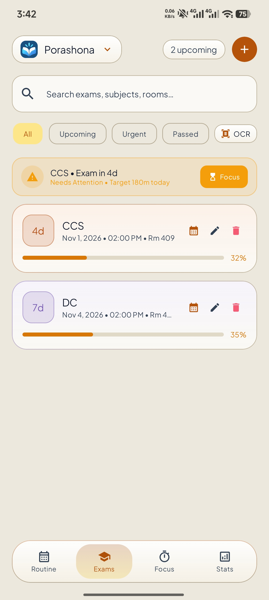
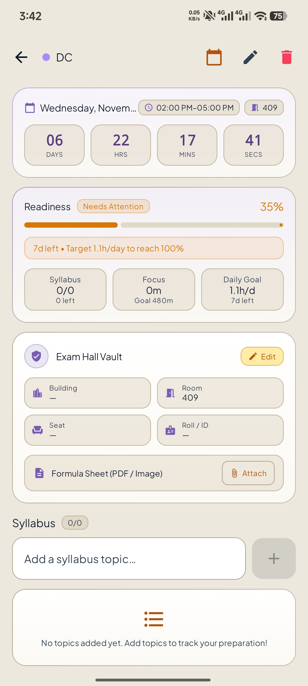
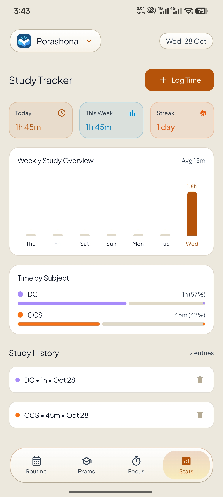
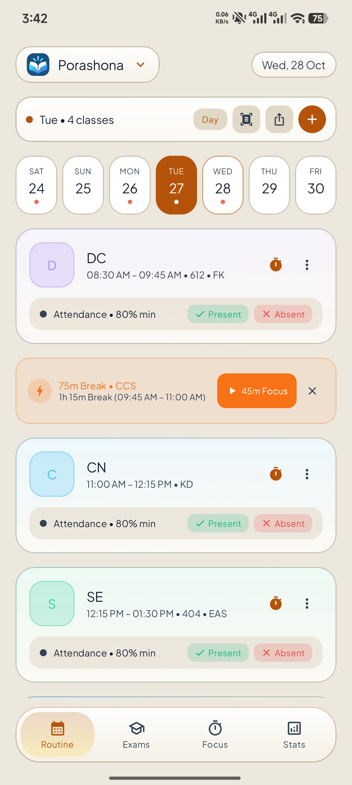

<div align="center">
  
  <h1>Porashona</h1>
  <p><strong>A calmer way to stay ready for exams.</strong></p>
  <p>Plan exams, follow your syllabus, focus with intention, and keep your class routine close at hand.</p>
  <p>
    <a href="https://tinyurl.com/mvhbfe5f"><strong>Download for Android</strong></a>
    &nbsp;·&nbsp;
    <a href="https://itsnaresh.me/porashona-privacy/">Privacy policy</a>
  </p>
  <p>
    <a href="https://www.android.com/"></a>
    <a href="https://kotlinlang.org/"></a>
    <a href="https://developer.android.com/compose"></a>
  </p>
</div>

## See Porashona

<table>
  <tr>
    <td align="center"><strong>Exam overview</strong><br></td>
    <td align="center"><strong>Exam details & syllabus</strong><br></td>
  </tr>
  <tr>
    <td align="center"><strong>Study statistics</strong><br></td>
    <td align="center"><strong>Weekly class routine</strong><br></td>
  </tr>
</table>

## Make exam prep feel manageable

- **Know what’s coming:** Add subjects, exam dates, times, and rooms. Sort or filter exams by date, urgency, and readiness.
- **Track syllabus progress:** Break a subject into topics and see how prepared you are for each exam.
- **Build a steady study habit:** Log study sessions, review weekly activity and time by subject, and track your streak.
- **Focus with Pomodoro:** Run focus and break sessions, then save completed focus time to your study history.
- **Keep your timetable handy:** Organize weekly classes with rooms and professors, and see what is happening now or next.
- **Get useful reminders:** Schedule exam notifications and add a home-screen widget for upcoming exams.
- **Save time on setup:** Scan timetable images with text recognition, and export your schedule or backup data.
- **Settle into your style:** Choose a light, dark, or system theme.

## Privacy

Porashona is designed to work without an account. Exam, syllabus, routine, and study-tracking data are stored locally on your device. The app also includes optional network-backed features; see the [privacy policy](https://itsnaresh.me/porashona-privacy/) for details.

## Built with

- Kotlin and Jetpack Compose with Material 3
- AndroidX Navigation and lifecycle components
- Room for structured local data and DataStore for preferences
- Kotlin Coroutines, Retrofit, and OkHttp
- Google ML Kit text recognition for timetable scanning

## Run locally

### Requirements

- Android Studio with the Android SDK for API 36
- JDK 11 or newer (the Gradle build uses Java 11 source and target compatibility)
- An Android device or emulator running Android 7.0 (API 24) or newer

1. Clone this repository and open the project folder in Android Studio.
2. Let Android Studio sync the Gradle project and install any requested SDK components.
3. Select the `app` run configuration and launch it on a device or emulator.

The app can run locally without a Gemini key. To use optional Gemini-powered image recognition, add your own key to the root `.env` file:

```dotenv
GEMINI_API_KEY=your_key_here
```

The Secrets Gradle Plugin reads `.env`. Do not commit API keys, signing keys, or passwords.

## Build

On Windows:

```powershell
.\gradlew.bat assembleDebug
```

On macOS or Linux:

```bash
./gradlew assembleDebug
```

The debug APK is written to `app/build/outputs/apk/debug/`. A release build requires your own signing configuration; keep signing credentials outside source control.

## Project layout

```text
app/src/main/java/com/example/
├── data/          # Room database, DAOs, models, and repository
├── notification/  # Exam reminder notifications
├── receiver/      # Notification and device-boot receivers
├── ui/            # Compose screens, navigation, and view models
├── util/          # OCR, date, calendar, and backup helpers
└── widget/        # Home-screen exam widget
```

## Contributing

Bug reports and focused pull requests are welcome. Please include clear steps to reproduce any reported issue.

## License

No license is currently specified. All rights are reserved unless the project owner grants permission. Add a license file before redistributing or reusing this project.

---

Made by [Naresh Barua](https://github.com/NareshBaruaIsHere).
